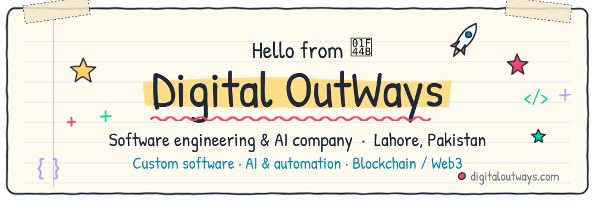
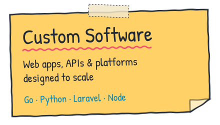
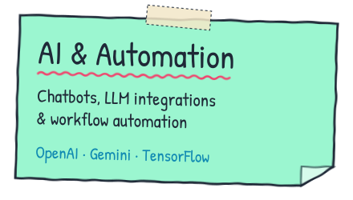
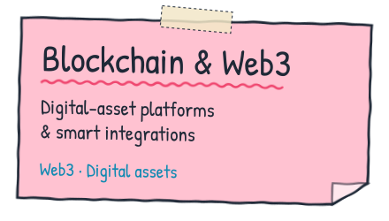
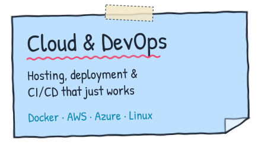
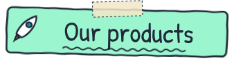
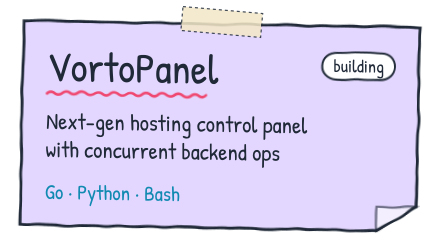
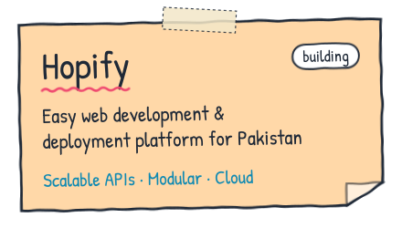
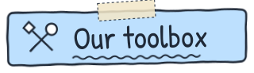
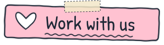

  

  

  
  
  

**Digital OutWays** is a software engineering & AI company from **Lahore, Pakistan** 🇵🇰. We help startups and businesses design, build and scale digital products — from the first API to production infrastructure.

<table>
  <tr>
    <td width="50%"></td>
    <td width="50%"></td>
  </tr>
  <tr>
    <td width="50%"></td>
    <td width="50%"></td>
  </tr>
</table>

<table>
  <tr>
    <td width="50%"></td>
    <td width="50%"></td>
  </tr>
</table>

  

Have a project in mind? We'd love to hear about it ✏️  
📩 **[growth@digitaloutways.com](mailto:growth@digitaloutways.com)** · 🌐 **[digitaloutways.com](https://digitaloutways.com)**

